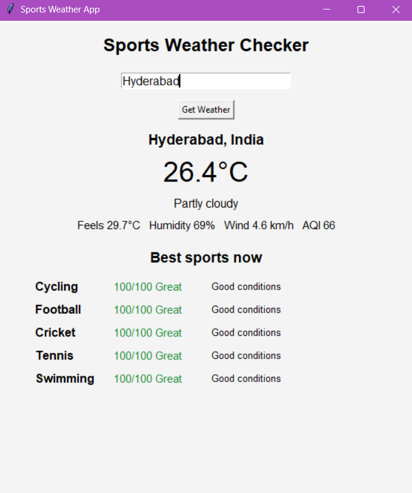

# Sports Weather App

Desktop app built with Python `tkinter`. Enter a city, get current weather and a ranked list of sports that suit conditions right now.

## Features

- Current weather: temperature, feels-like, humidity, wind, condition
- Air quality index (US AQI) for outdoor safety
- Rule-based sport suggestions, top 5, scored 0-100 with reason
- 10 sports: Running, Cycling, Football, Cricket, Tennis, Hiking, Swimming, Badminton, Gym, Yoga
- No API key needed, uses free [Open-Meteo](https://open-meteo.com/) APIs
- OOP structure, logic split from GUI

## Screenshot

![App screenshot]

## Tech Stack

- Python 3.8+
- `tkinter` (built in)
- `requests`
- Open-Meteo Geocoding, Forecast, Air Quality APIs

## Project Structure

```
Sports_Weather_App/
  weather_app.py     # tkinter GUI, API calls
  sports.py          # scoring rules and sport suggestions
  requirements.txt
  README.md
```

## Setup

```bash
git clone https://github.com/OneAbhik/Sports_Weather_App.git
cd Sports_Weather_App
python -m venv venv
```

Activate venv:

- Windows: `venv\Scripts\activate`
- Linux/Mac: `source venv/bin/activate`

Install and run:

```bash
pip install -r requirements.txt
python weather_app.py
```

Linux only, if `tkinter` missing: `sudo apt install python3-tk`

## How It Works

1. City name goes to Open-Meteo Geocoding API, returns latitude and longitude.
2. Coordinates go to Forecast API for current weather, and Air Quality API for AQI.
3. `sports.py` scores each sport from 100, subtracting penalties:
   - Rain, thunderstorm
   - Unhealthy air (for AQI-sensitive sports)
   - Strong wind
   - Feels-like temp outside sport's ideal range
   - Heat plus high humidity
4. Indoor sports score higher when outdoor conditions are bad.
5. Top 5 shown with verdict: Great (80+), OK (60-79), Poor (below 60).

## Customize

Edit `SPORTS` dict in `sports.py` to change temp ranges, wind limits, or add sports.

```python
"Running": {"outdoor": True, "temp": (8, 26), "max_wind": 30, "rain_ok": False, "aqi_sensitive": True},
```

## Roadmap

- [ ] Threading so UI never freezes during requests
- [ ] Hourly forecast, best time slot for a sport
- [ ] Sport filter dropdown
- [ ] Celsius/Fahrenheit toggle
- [ ] Unit tests with `pytest`
- [ ] Package as `.exe` with PyInstaller

## License

MIT